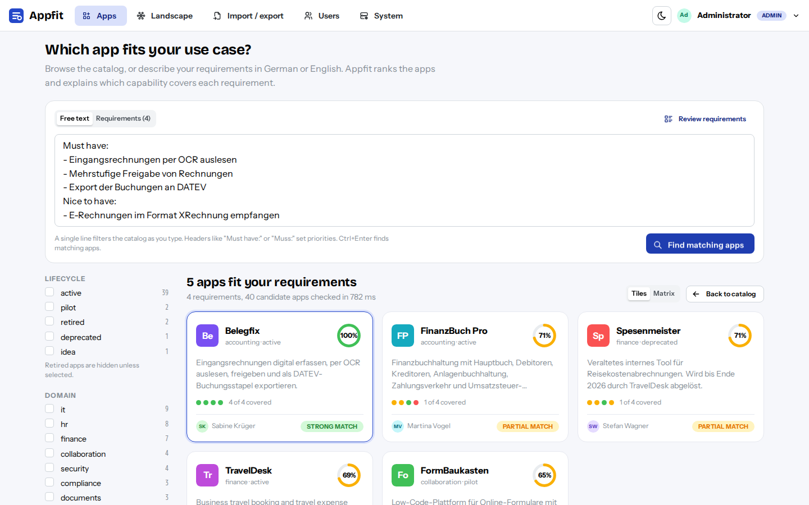
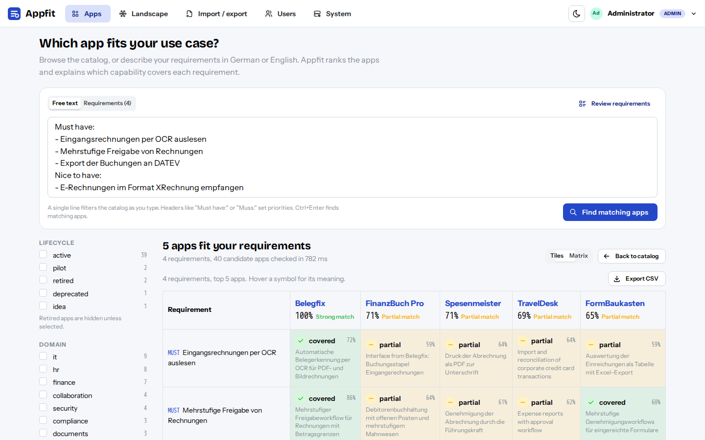
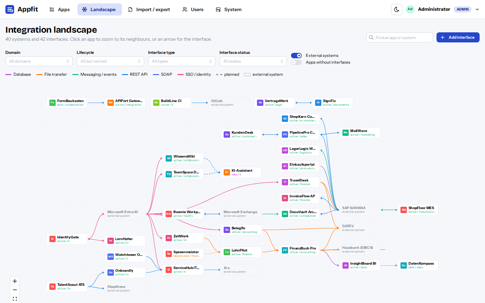

# Appfit

[](LICENSE)


Appfit is a catalog of the applications in your organization: what each app can do, who maintains it, its tech stack, license and lifecycle, and how the apps are connected through interfaces. Users describe a use case as a list of requirements, in German or English, and Appfit returns the apps that match best. For every result it **explains** which requirement is covered by which capability and where the gaps are. It says so clearly when nothing in the catalog fits.

- **Backend:** Python 3.12, FastAPI, SQLAlchemy 2, PostgreSQL 17 + pgvector (hybrid vector + full-text search)
- **Embeddings:** local `BAAI/bge-m3` via sentence-transformers (multilingual DE/EN, no external API)
- **Frontend:** React 19, TypeScript, Mantine 9, TanStack Query, React Router, typed client generated from OpenAPI
- **Auth:** local users with roles `viewer` < `editor` < `admin`. Sessions are JWTs in an httpOnly cookie. An `AuthProvider` seam leaves room for OIDC.



<table>
  <tr>
    <td></td>
    <td></td>
  </tr>
  <tr>
    <td align="center">Coverage matrix with the evidence per cell, exportable as CSV</td>
    <td align="center">Integration landscape: apps, external systems and their interfaces</td>
  </tr>
</table>

## Quick start

Requirements: Docker with Compose. For local development also [uv](https://docs.astral.sh/uv/). Node is not required; frontend tooling runs in a container.

```bash
cp .env.example .env            # set JWT_SECRET (32+ random characters) and BOOTSTRAP_ADMIN_PASSWORD
make up                         # builds and starts db, backend, frontend on http://localhost:8080
make db && make setup && make seed   # optional: load the 45-app demo catalog (backend/eval/seed_apps.json)
```

What happens on startup:
- The backend applies database migrations.
- If the users table is empty, it creates the bootstrap admin from `BOOTSTRAP_ADMIN_*`. Change that password after the first login.
- It loads the embedding model. The first start downloads about 2.2 GB into the `hf-cache` volume.
- `/api/health/ready` returns 200 once the model is loaded. Until then, catalog and keyword search already work, and matching answers 503.

Useful commands:
- `make help` lists all commands.
- `make dev` starts hot reload: API on :8000, UI on :5173, Postgres on :5432.
- API docs are at `/api/docs` (Swagger UI). The spec is committed as [`docs/openapi.yaml`](docs/openapi.yaml).

## API

The REST API is described by an OpenAPI 3.1 spec, [`docs/openapi.yaml`](docs/openapi.yaml). It is generated from the code (`make gen-api`), and a test fails when the committed file is stale. The running API serves the same document at `/api/openapi.json`.
- Auth: `POST /api/auth/login` sets a session cookie and returns the token for `Authorization: Bearer` use. Cookie-authenticated writes must send `X-Requested-With`.
- Each operation lists its minimum role (`x-required-role`: viewer, editor or admin) and every error it can return. Errors are `{"detail": "..."}`, validation errors (422) list the fields.
- The frontend's typed client (`frontend/src/api/schema.d.ts`) is generated from the spec.

Every endpoint is tested against the spec in `backend/tests/contract/`:
- `test_tour.py` walks through all operations with realistic data and validates each response against the spec. It fails when a new operation is not covered.
- `test_fuzz.py` uses [Schemathesis](https://schemathesis.readthedocs.io) to send generated requests to every operation. It checks for server errors, undocumented status codes and content types, response bodies that break the schema, and missing auth checks. For a deeper run: `FUZZ_EXAMPLES=500 make test-backend`.

## Interfaces and the integration landscape

An **interface** is a documented data flow from one endpoint to another. Each endpoint is a catalog app or an **external system** that is not in the catalog (SAP, DATEV, a bank). External systems are created by name the first time an interface uses them.

- Fields: name, type (REST API, SOAP, file transfer, database, messaging, SSO / identity, UI embedding, other), data objects, frequency (real-time, batch, on demand), status (planned, active, deprecated), "both directions" and a description.
- Editors add, edit and delete interfaces on an app's page or on the **Landscape** page. Deleting an app deletes its interfaces; an external system can only be deleted once no interface uses it.
- **Landscape** (`/landscape`) shows all apps and external systems as a graph with a left-to-right layout: data flows from providers on the left to consumers on the right.
  - Filter by domain, lifecycle, interface type and status; external systems and apps without interfaces can be shown or hidden.
  - Click an app to zoom to its neighbours and see its interfaces; click an arrow to see the interface.
  - Colours show the interface type; planned interfaces are dashed, deprecated ones faded.
- Each app page shows its interfaces as a list and as a small graph of its direct neighbours.

## How matching works

The implementation is in `backend/src/appfit/services/search/`.

1. **Split.** The input becomes individual requirements. Bullets, numbering and long sentences are split, and German abbreviations are protected.
   - Headers such as `Must have:` / `Muss:`, `Should:` / `Soll:` and `Nice to have:` / `Kann:` set the priority (weights 1.0 / 0.6 / 0.3). So do inline markers like `(optional)` or `Pflicht: ...`.
   - In the UI, the parsed list can be edited before searching again.
   - The apps page is also the catalog: a single line in the search field filters it by keyword, and the facets (lifecycle, domain, license) apply to browsing and matching alike.
   - Results appear as tiles. Clicking a tile opens the evidence. The "Matrix" view shows requirements x apps with the matching capability in each cell and exports to CSV; the choice is remembered per browser.
2. **Retrieve candidates** with three ranked lists fused by Reciprocal Rank Fusion:
   - the app summary vector compared with the whole text
   - each requirement compared with the capability vectors
   - German and English full-text search, OR-combined
3. **Score evidence per requirement and app.** The score is the best capability's cosine similarity, plus a small bonus when stemmed keywords overlap.
   - The app description can support a requirement, but is capped below the "covered" threshold. Only a concrete capability counts as covered.
   - Each requirement becomes **covered**, **partial** or **gap**.
   - App score = `0.6 * weighted coverage + 0.3 * soft similarity + 0.1 * retrieval rank`.
   - A missing must-have multiplies the score by 0.75.
4. **Interfaces as evidence.** A documented interface also counts as evidence for the apps at its ends. "Integration mit SAP S/4HANA" is covered by an active interface to SAP S/4HANA even when no capability says so.
   - Each app side is embedded as a short sentence that names the other side ("Buchungsstapel - Integration mit FinanzBuch Pro"). On the labelled pairs this matched much better than one neutral sentence per interface.
   - A planned interface can make a requirement partial at most; deprecated interfaces are ignored.
   - The results also show **how the apps connect**: interfaces between the result apps, external systems two or more of them share, and connected pairs that cover more requirements together than either app alone.
5. **No match.** If the best app scores below `nomatch` or covers too little (`min_top_coverage`), the UI shows a "no good match" banner with the closest candidates marked as not recommended.
   - Requirements that no app covers are always listed as catalog gaps.
   - Results scoring below half of the best result are hidden.

Thresholds are calibrated per model in `services/search/thresholds.yaml` and can be overridden with `MATCH_T_*` env vars. The current bge-m3 values come from the labelled eval set.

### Evaluation and calibration

`backend/eval/` contains:
- `seed_apps.json`: 45 fictional enterprise apps with 524 atomic capabilities, mixed German and English, plus 8 external systems and 43 interfaces
- `queries.yaml`: 57 use cases with graded relevance, 9 of them expecting "no match" and 7 that depend on interfaces
- `pair_labels.yaml`: 174 (requirement, app) pairs labelled covered, partial or none, 22 of them decided by an interface

Commands:
- `make eval` reports recall@k, MRR, nDCG@10 and no-match accuracy.
- `make eval-sweep` also suggests thresholds.

The committed baseline is `eval/baseline-bge-m3.json`. Current results:

| Metric | Value |
|---|---|
| MRR | 0.979 |
| recall@5 | 0.969 |
| recall@10 | 0.979 |
| nDCG@10 | 0.961 |
| No-match balanced accuracy | 0.979 |
| "Covered" precision / recall | 0.79 / 0.82 |
| Partial-or-better precision / recall | 0.88 / 0.99 |

On the original 50 queries and 152 pairs alone, no metric dropped when interfaces were added (recall@5 and nDCG@10 rose).

Recalibrate after changing the model, the scoring, or when search feedback suggests drift. Thumbs-down feedback with an expected app is stored in `search_logs` and is the natural source of new eval cases.

## Data management

- **UI:** editors create and edit apps. Capabilities should be short, single statements, and the editor warns about long ones.
- **Import:** at `/import` or with `appfit seed <file>`.
  - Formats: CSV (`,` `;` or tab separated, UTF-8 or Windows-1252) or JSON (`{"version": 1, "apps": [...]}`). The JSON schema is at `/api/import/schema.json` and a CSV template is available in the UI.
  - A JSON file can also hold `external_systems` and `interfaces`. They are applied after the apps, so an interface may refer to an app defined in the same file. An endpoint is `{"app": "<slug>"}` or `{"system": "<name>"}`.
  - Interfaces can also come as their own CSV (detected by its `from` and `to` columns): `from,to,name,type,data_objects,frequency,status,bidirectional,description`, with endpoints written as `app:<slug>` or `system:<name>`. Interfaces are matched by both endpoints and the name. A template is available in the UI.
  - Every upload starts as a dry run with a per-row report.
  - Apps are matched by `slug`. In CSV, a missing column keeps the current value and an empty cell clears it. In JSON, a missing key keeps the value and `null` clears it.
  - Collections that are present replace the current set. Unchanged capabilities keep their embeddings.
- **Export:** JSON and CSV exports use the same format, so exported files can be re-imported unchanged. The JSON export includes external systems and interfaces; interfaces have their own CSV export.
- **Embeddings:** a background worker inside the API process embeds new and changed texts, usually within seconds. The System page shows progress. "Rebuild full index" re-embeds everything, which is needed after switching `EMBEDDING_MODEL`.
  - A model with a different vector dimension also needs a migration that alters `vector(1024)`; see migration 0003.
  - To run the worker as its own process, set `EMBED_WORKER_ENABLED=false` and run `appfit worker`.

## Development

```bash
make setup           # backend venv in ~/.venvs/appfit (fast on WSL), frontend deps in a docker volume
make db              # Postgres with pgvector on localhost:5432
make test            # backend (pytest, real pgvector, fake embedder) + frontend (Vitest)
make test-model      # opt-in tests with the real bge-m3 model
make e2e             # Playwright smoke tests against a running, seeded stack
                     # (E2E_ADMIN_PASSWORD=...)
make lint            # ruff, mypy, eslint, tsc
make gen-api         # regenerate docs/openapi.yaml and src/api/schema.d.ts after API changes
make helm-lint       # lint the Helm chart and validate its manifests (helm, kubeconform)
```

Layout:
- `backend/src/appfit/`
  - `api/routers`: HTTP layer; `api/openapi.py` adds auth, roles and error responses to the spec
  - `services`: catalog, interfaces, importer, search, embedding sync
  - `ml`: embedders
  - `models`, `schemas`
  - `config.py`: every tunable constant and setting
- `backend/alembic/`: migrations
- `docs/openapi.yaml`: the API spec (generated)
- `deploy/helm/appfit`: the Helm chart
- `frontend/src/`
  - `pages`, `components/{portal,search,graph,interfaces,apps,import}`
  - `api`: generated types and query hooks
  - `config.ts`: UI constants

## Kubernetes

A Helm chart is in [`deploy/helm/appfit`](deploy/helm/appfit/README.md).
- It deploys the API, the UI and optionally PostgreSQL with pgvector and a separate embedding worker.
- Secrets are generated, and the model is cached on a volume.
- The ingress is optional.

```bash
helm install appfit deploy/helm/appfit -n appfit --create-namespace \
  --set backend.image.repository=registry.example.com/appfit/backend \
  --set frontend.image.repository=registry.example.com/appfit/frontend
```

`make helm-lint` checks the chart. `make helm-kind` installs it into a local kind cluster and runs `helm test`.

## Operations

- **Backups:** everything lives in the `pgdata` volume. For example:
  `docker compose exec db pg_dump -U appfit -Fc appfit > appfit-$(date +%F).dump`
  Restore with `pg_restore --clean -d appfit`.
  Embeddings are included in the dump. If they are missing, the worker recreates them.
- **Offline model:** after the first start, set `HF_HUB_OFFLINE=1` so the backend never contacts the model hub. Pin `EMBEDDING_MODEL_REVISION` for reproducible embeddings.
- **Security:**
  - Serve behind TLS and set `COOKIE_SECURE=true`.
  - Use a random `JWT_SECRET` of at least 32 characters. The API refuses to start with a shorter one or the example value.
  - The API expects same-origin requests (nginx proxies `/api`). Cookie-authenticated writes must send `X-Requested-With`.
  - Scripts can use `Authorization: Bearer <token>` from `/api/auth/login`.
- **Performance:** a search takes about 0.3-0.5 s on CPU. Embedding the demo catalog takes about 1 minute on CPU. A GPU profile needs a CUDA 12.8+ torch build and `EMBEDDING_DEVICE=cuda`.

## Known limitations

- Negations and exclusions ("must not be SaaS") cannot be understood through embeddings. Use the filters (lifecycle, tags, license type) for such constraints.
- Compound requirements ("export to SAP *and* DATEV") can look covered when only half is fulfilled. Write requirements atomically.
- Heavily paraphrased cross-lingual requirements can score low. In the eval, 2 of 41 queries were wrongly reported as "no match". The next step is a cross-encoder reranker such as `BAAI/bge-reranker-v2-m3` for the top evidence pairs, adopted only if `make eval` shows a gain.
- Very generic capabilities (SSO, REST API, audit log) exist in many apps. They show up as evidence but rarely decide the ranking.

## Contributing, security and license

- Contributions are welcome; see [CONTRIBUTING.md](CONTRIBUTING.md).
- Please report vulnerabilities privately as described in [SECURITY.md](SECURITY.md).
- Changes per release are in [CHANGELOG.md](CHANGELOG.md).
- Appfit is released under the [MIT License](LICENSE).
